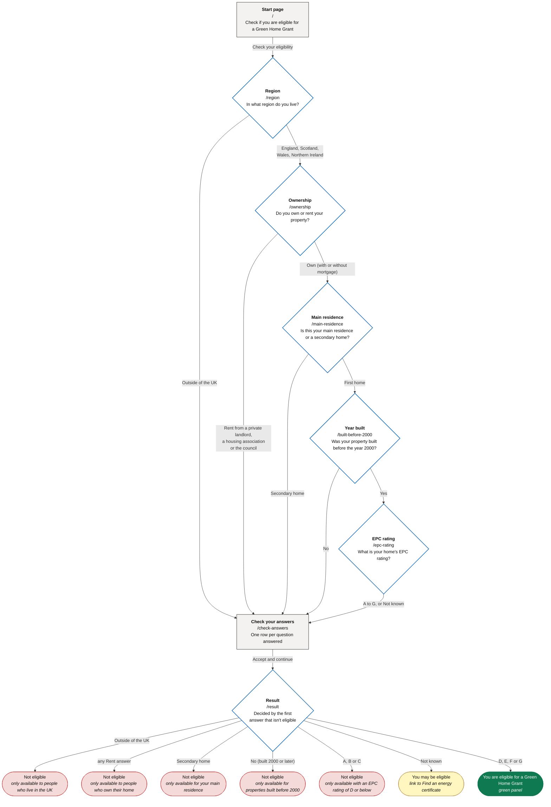
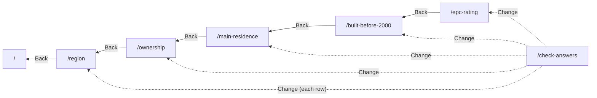

# Journey flow

How a user moves from page to page in "Check if you are eligible for a Green Home Grant". It matches the routing in the code: each question page's `nextPage` and `src/journeyPath.js`. See also `route.md`.

## The journey

Every path goes through **Check your answers** before the result. An answer that means "not eligible" skips the remaining questions.

## Going back and changing answers

- **"Back" links** go to the page before in the journey. Check your answers and the results page have no "Back" link.
- **"Change" links** on Check your answers open that question with the answer selected. From there, the normal journey is followed.
- **The browser's Back button** works as normal. From a result, it returns to Check your answers.

## Pages opened directly by address

| Address | When | What happens |
|---|---|---|
| `/check-answers` | A question on the user's path is unanswered (including the region) | Sends the user to the first page `/` |
| `/result` | "Accept and continue" hasn't been pressed since the last answer was saved | Sends the user to the first page `/` |
| `/result` | A question on the user's path is unanswered | Sends the user to the first page `/` |
| Any question page | Any time | Shows the question, with the saved answer selected if there is one |

Saving any answer undoes an earlier "Accept and continue", so the user has to check and accept their answers again.

## Pages outside the journey

- **Cookies** (`/cookies`): reached from the cookie banner's "View cookies" and "change your cookie settings" links.
- **Accessibility statement** (`/accessibility-statement`): reached from the footer.
- **Language navigation** (English | Cymraeg): on every page, it switches the language and stays on the same page.
